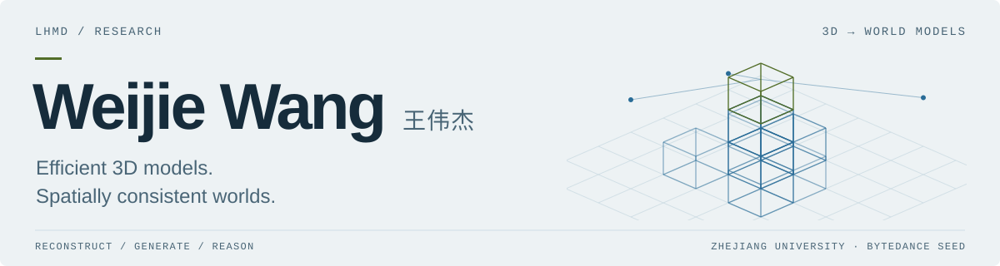
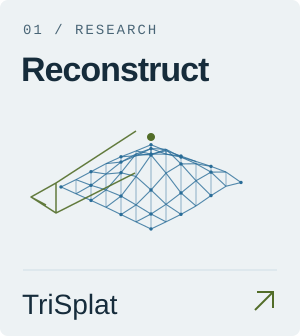
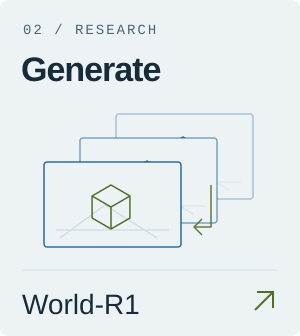
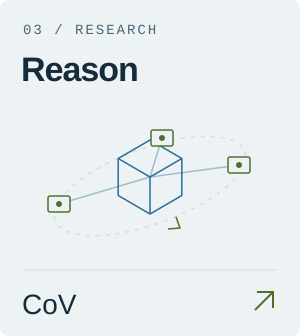

<picture>
  <source media="(prefers-color-scheme: dark)" srcset="assets/profile-header-dark.svg">
  <source media="(prefers-color-scheme: light)" srcset="assets/profile-header-light.svg">
  
</picture>

**Ph.D. @ [Zhejiang University](https://www.zju.edu.cn/english/) · Research Intern @ [ByteDance Seed](https://seed.bytedance.com/en/)** Advised by [Bohan Zhuang](https://bohanzhuang.github.io/). Previously at [Microsoft Research Asia](https://www.microsoft.com/en-us/research/lab/microsoft-research-asia/).

I work on **efficient 3D models and world models** — reconstructing scenes, generating consistent worlds, and reasoning about space.

**[Homepage](https://lhmd.top/)** &nbsp; / &nbsp; **[Scholar](https://scholar.google.com/citations?user=Hsxmwr0AAAAJ)** &nbsp; / &nbsp; **[Email](mailto:wangweijie@zju.edu.cn)** &nbsp; / &nbsp; **[X](https://x.com/wjwang2003)**

## Research

  <a href="https://github.com/ziplab/TriSplat"><picture>
    <source media="(prefers-color-scheme: dark)" srcset="assets/research-reconstruct-dark.svg">
    <source media="(prefers-color-scheme: light)" srcset="assets/research-reconstruct-light.svg">
    
  </picture></a>
  <a href="https://github.com/microsoft/World-R1"><picture>
    <source media="(prefers-color-scheme: dark)" srcset="assets/research-generate-dark.svg">
    <source media="(prefers-color-scheme: light)" srcset="assets/research-generate-light.svg">
    
  </picture></a>
  <a href="https://github.com/ziplab/CoV"><picture>
    <source media="(prefers-color-scheme: dark)" srcset="assets/research-reason-dark.svg">
    <source media="(prefers-color-scheme: light)" srcset="assets/research-reason-light.svg">
    
  </picture></a>

Explore all projects

- **3D reconstruction:** [TriSplat](https://lhmd.top/trisplat/) · [VolSplat](https://lhmd.top/volsplat/) · [ZPressor](https://lhmd.top/zpressor/) · [PM-Loss](https://aim-uofa.github.io/PMLoss/) · [Feed-Forward 3D Survey](https://ff3d-survey.github.io/)
- **World generation:** [Latent Spatial Memory](https://aka.ms/latent-spatial-memory) · [World-R1](https://aka.ms/world-r1) · [WonderTurbo](https://wonderturbo.github.io/) · [DriveGen3D](https://lhmd.top/drivegen3d/)
- **Spatial reasoning:** [CoV](https://ziplab.co/CoV/) · [MV-RoboBench](https://github.com/microsoft/MV-RoboBench) · [ReVisual-R1](https://github.com/CSfufu/Revisual-R1) · [DDP](https://hhx-jpg.github.io/ddp/)

Full publications, talks, and updates → **[lhmd.top](https://lhmd.top/)**

<!-- Optional profile counter: remove this comment block to display it again.

-->
